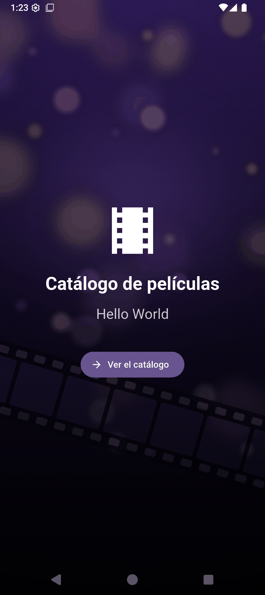
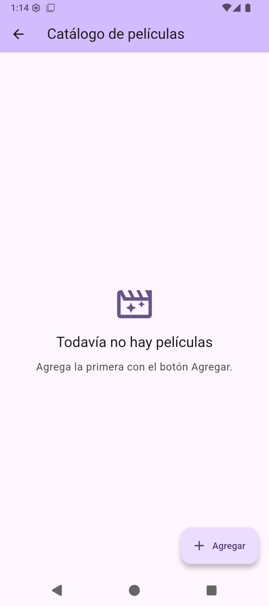
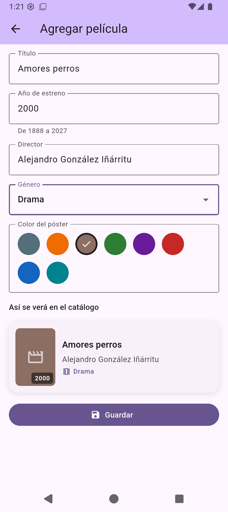

# Catálogo de películas

Hiram Agustín Acevedo López · Licenciatura en Desarrollo de Sistemas Web

Aplicación en Flutter de la unidad 3 de Diseño de aplicaciones móviles. En la actividad 3.7 es el catálogo de películas de las actividades 3.4 y 3.5, ahora con su base de datos en Cloud Firestore: el catálogo lee las películas de la base y un formulario agrega películas nuevas. Cada actividad queda fija en una etiqueta del repositorio:

| Etiqueta | Actividad | Qué hay |
|---|---|---|
| `act-3.4` | 3.4. Utilización de widgets | la pantalla del catálogo de películas, con Text, Row, Column, Stack y Container |
| `act-3.5` | 3.5. Home screen | la pantalla de inicio del catálogo, con la imagen de fondo, el icono y el mensaje Hello World |
| `act-3.6` | 3.6. Peticiones HTTP | una Pokédex con los datos de PokéAPI |
| `act-3.7` | 3.7. Integración de base de datos | el catálogo conectado a Cloud Firestore, con el formulario para agregar películas |

## Cloud Firestore (actividad 3.7)

Las películas ya no están escritas en el código: viven en la colección `peliculas` de Cloud Firestore, en el proyecto de Firebase `ldsw-catalogo-peliculas`. Seguí la guía Add Firebase to your Flutter app (firebase.google.com/docs/flutter/setup):

1. Con la Firebase CLI, `firebase login` y el proyecto `ldsw-catalogo-peliculas`, en el plan gratuito Spark.
2. Con la FlutterFire CLI, `flutterfire configure` para Android y web. Registró las dos apps en el proyecto y escribió `lib/firebase_options.dart`, `android/app/google-services.json` y `firebase.json`.
3. Los paquetes `firebase_core` y `cloud_firestore` en `pubspec.yaml`.
4. `main` llama a `Firebase.initializeApp` con `DefaultFirebaseOptions.currentPlatform` antes de `runApp`.

| Pantalla | Qué hace con la base |
|---|---|
| `InicioPage` | nada; el botón Ver el catálogo abre la lista |
| `CatalogoPage` | escucha la colección `peliculas`, ordenada por título, con `snapshots()` y un `StreamBuilder`: una película nueva aparece sin recargar |
| `AgregarPeliculaPage` | valida el formulario y guarda la película con `add`; al terminar regresa al catálogo con el aviso de que se agregó |

Cada película es un documento con seis campos:

| Campo | Tipo | Ejemplo |
|---|---|---|
| `titulo` | texto | Roma |
| `anio` | entero | 2018 |
| `director` | texto | Alfonso Cuarón |
| `genero` | texto | Drama |
| `color` | entero, el color del póster en ARGB | 4283723386 |
| `creada` | marca de tiempo que pone el servidor | 10 de noviembre de 2026, 01:19 |

`Pelicula.fromFirestore` y `toFirestore` (`lib/pelicula.dart`) convierten el documento en un objeto y de vuelta, y `withConverter` los usa en `lib/repositorio_peliculas.dart`. Las pantallas reciben ese repositorio por su constructor; por eso las pruebas pueden darles una base simulada.

Las reglas de `firestore.rules` dejan leer el catálogo y agregar una película sólo si trae los seis campos con su tipo, un año de 1888 al año que entra y la hora del servidor. Nadie modifica ni borra mientras la app no tenga inicio de sesión. La base está en `nam5`, la ubicación de varias regiones de Estados Unidos.

Las cuatro películas del catálogo (Roma, Coco, Amores perros y El laberinto del fauno, las mismas de las actividades 3.4 y 3.5) se agregaron con el formulario, en el emulador.

En esta versión la app es sólo el catálogo; la Pokédex de la actividad 3.6 sigue en su etiqueta.

## Abrir el proyecto

1. Clona el repositorio.
2. Con Flutter 3.47.5 instalado, entra a la carpeta y corre `flutter pub get`.
3. Enciende un emulador de Android (o conecta un teléfono) y corre `flutter run`.

La configuración de Firebase viene en el repositorio, así que la app se conecta a la misma base sin pasos extra. Necesita conexión a internet para leer y guardar películas.

## Pruebas

`flutter test` corre 22 pruebas. Ninguna sale a internet: usan una base de Firestore simulada en memoria, del paquete `fake_cloud_firestore`.

- `test/pelicula_test.dart`, cuatro: los campos y tipos que escribe `toFirestore`, la lectura de un documento con su id, su color y su fecha, el error con un documento incompleto y el documento que crea `agregar`.
- `test/catalogo_test.dart`, nueve: las seis de la actividad 3.4 (Text, Row, Column, Stack y Container), ahora con las películas de la base; el aviso con la base vacía; el mensaje cuando la base responde con un error; y una película que llega a la base y aparece sola en su lugar.
- `test/agregar_pelicula_test.dart`, cuatro: el formulario vacío dice qué falta; el año sólo acepta cifras y va de 1888 al año que entra; la vista previa sigue lo que se escribe; y, desde el catálogo, la película se guarda en la base y aparece en la lista.
- `test/inicio_test.dart`, cinco: las de la actividad 3.5, con la base simulada.

Hecho con Flutter 3.47.5 (Dart 3.13.4), `firebase_core` 5.1.0 y `cloud_firestore` 7.1.0. Probado en el emulador Pixel 9 con Android 16.
