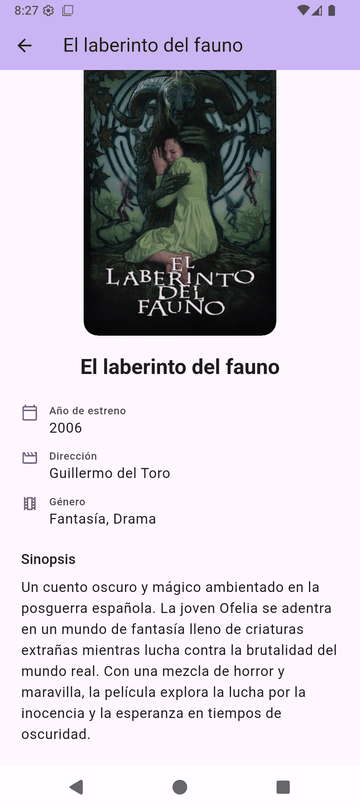
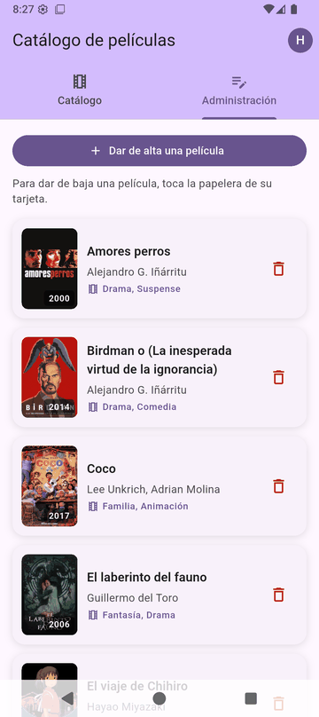
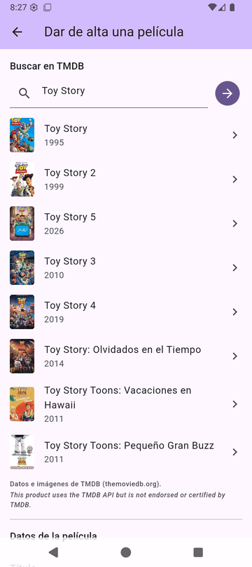
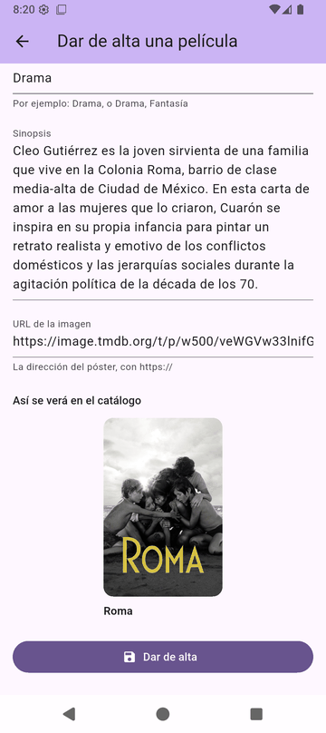

# Catálogo de películas

Hiram Agustín Acevedo López · Licenciatura en Desarrollo de Sistemas Web

Aplicación en Flutter de Diseño de aplicaciones móviles. El producto integrador junta lo de la unidad 3 en una sola app: el catálogo de películas de las actividades 3.4 y 3.5, las peticiones HTTP de la 3.6 y la base de datos de la 3.7, ahora con cuentas de usuario y una pantalla para administrar el catálogo. Cada actividad queda fija en una etiqueta del repositorio:

| Etiqueta | Actividad | Qué hay |
|---|---|---|
| `act-3.4` | 3.4. Utilización de widgets | la pantalla del catálogo con Text, Row, Column, Stack y Container |
| `act-3.5` | 3.5. Home screen | la pantalla de inicio con la imagen de fondo, el icono y el mensaje Hello World |
| `act-3.6` | 3.6. Peticiones HTTP | una Pokédex con los datos de PokéAPI |
| `act-3.7` | 3.7. Integración de base de datos | el catálogo conectado a Cloud Firestore, con un formulario para agregar películas |
| `act-pi` | Producto integrador | inicio con registro e ingreso, catálogo, descripción y administración, con Firebase y TMDB |

## Las cuatro pantallas

| Pantalla | Qué hace |
|---|---|
| Inicio (`lib/inicio.dart`, `lib/cuenta.dart`) | La bienvenida, sobre la imagen de fondo de la 3.5, y las dos opciones: **Crear cuenta** (nombre, correo y contraseña) o **Ya tengo cuenta** (correo y contraseña). Sin sesión no se ve el catálogo. |
| Catálogo (`lib/catalogo.dart`) | El póster y el título de cada película, en una cuadrícula ordenada por título. Se actualiza solo: un alta o una baja se ve sin recargar. |
| Descripción (`lib/descripcion.dart`) | Al tocar una película: el póster, el título, el año de estreno, quién la dirigió, el género y la sinopsis. |
| Administración (`lib/administracion.dart`, `lib/alta.dart`) | **Dar de alta una película** abre el formulario: título, año, director, género, sinopsis y URL de la imagen, con una vista previa de cómo se verá. Arriba, una búsqueda en TMDB llena esos datos al elegir la película. La papelera de cada tarjeta la **da de baja**, después de confirmar. |

Arriba, debajo del título, el menú de pestañas cambia entre Catálogo y Administración. El círculo con la inicial abre el menú de la cuenta: quién ingresó, Acerca de y Cerrar sesión.

## Firebase

El proyecto de Firebase es el de la actividad 3.7, `ldsw-catalogo-peliculas`, en el plan gratuito Spark. La configuración (`lib/firebase_options.dart`, `android/app/google-services.json` y `firebase.json`) viene en el repositorio, así que la app se conecta sin pasos extra.

- **Authentication**, con correo y contraseña: registrarse, ingresar y cerrar la sesión (`lib/sesion.dart`). La sesión sigue abierta al volver a abrir la app.
- **Cloud Firestore**, con dos colecciones nuevas (`lib/repositorio_catalogo.dart`):

| Colección | Un documento por | Campos |
|---|---|---|
| `catalogo` | película | `titulo`, `anio`, `director`, `genero`, `sinopsis`, `imagen` (la URL del póster), `tmdbId` (si vino de la búsqueda), `agregadaPor` (quién la dio de alta) y `creada` (la hora del servidor) |
| `usuarios` | usuario, con su uid | `nombre`, `correo` y `creado` |

Las reglas (`firestore.rules`) piden la sesión para leer el catálogo, dar de alta y dar de baja. Un alta sólo pasa con sus campos y sus tipos, un año de 1888 al año que entra, una URL que empiece con http y a nombre de quien la da de alta. Cada usuario lee y crea sólo su propio registro. Las películas no se editan: se dan de baja y se vuelven a dar de alta. La colección `peliculas` de la 3.7 conserva sus reglas.

## TMDB: las peticiones HTTP

La búsqueda de la pantalla de alta pide los datos a la API de TMDB con el paquete `http` (`lib/tmdb.dart`), en español de México:

1. `GET /3/search/movie?query=…` trae las películas con ese título: el nombre, el año y el póster en miniatura.
2. Al elegir una, `GET /3/movie/{id}?append_to_response=credits` trae su ficha. El director sale del equipo de filmación, el género de sus géneros y la sinopsis de su resumen; la imagen es la URL del póster en `image.tmdb.org`.

Los pósteres del catálogo también llegan por HTTP, con `Image.network`.

El token de TMDB no está en el repositorio. Para usar la búsqueda:

1. Crea una cuenta en [themoviedb.org](https://www.themoviedb.org) y, en Ajustes > API, pide una clave de desarrollador.
2. Copia `tmdb.example.json` como `tmdb.json` y pega ahí el **API Read Access Token** (o la API Key).
3. Corre la app con `flutter run --dart-define-from-file=tmdb.json`.

Sin el token, la app funciona igual y el formulario de alta se llena a mano.

Los datos y los pósteres de la búsqueda vienen de [TMDB](https://www.themoviedb.org). Como piden sus condiciones de uso, la app lo dice junto a la búsqueda y en Acerca de:

> This product uses the TMDB API but is not endorsed or certified by TMDB.

## Abrir el proyecto

1. Instala Flutter 3.50.0 y corre `flutter pub get` en la carpeta del proyecto.
2. Enciende un emulador de Android (o conecta un teléfono) y corre `flutter run --dart-define-from-file=tmdb.json`, o sólo `flutter run` si no vas a usar la búsqueda.
3. En la app, crea tu cuenta con tu correo y una contraseña de al menos 6 caracteres.

Para probar sin tocar la base real hay un modo de desarrollo con los emuladores locales de Firebase: `firebase emulators:start --only auth,firestore` y, en otra terminal, `flutter run --dart-define=EMULADORES=true`.

## Pruebas

`flutter test` corre 30 pruebas. Ninguna sale a internet: Firestore, Authentication y TMDB están simulados con `fake_cloud_firestore`, `firebase_auth_mocks` y un `MockClient` de `http`.

- `test/pelicula_test.dart`, seis: cómo se escribe y se lee una película, el documento incompleto, el alta, la baja y la búsqueda por id de TMDB.
- `test/tmdb_test.dart`, cinco: la dirección y los encabezados de cada petición, la búsqueda, la ficha con su director y sus géneros, los errores y la falta de token.
- `test/inicio_test.dart`, tres: la bienvenida con sus dos opciones, la imagen de fondo y los botones que abren el registro y el ingreso.
- `test/cuenta_test.dart`, cuatro: los avisos del registro, la cuenta nueva con su registro en `usuarios`, la contraseña equivocada y el ingreso.
- `test/catalogo_test.dart`, siete: el menú de pestañas, el catálogo con título y póster, la descripción con todos sus datos, el catálogo vacío, el error de la base, una película nueva que aparece sola y el menú de la cuenta.
- `test/administracion_test.dart`, cinco: la tarjeta de la 3.4 (Text, Row, Column, Stack y Container), la baja con confirmación, el alta a mano con sus avisos, el alta con TMDB y la película repetida.

Hecho con Flutter 3.50.0 (Dart 3.14.0), `material_ui` 1.11.0, `firebase_core` 5.1.0, `firebase_auth` 7.0.1, `cloud_firestore` 7.1.0 y `http` 1.6.0; en Android, Gradle 9.5.0, AGP 9.3.1 y Kotlin 2.4.20. Probado en el emulador Pixel 9 con Android 16.
