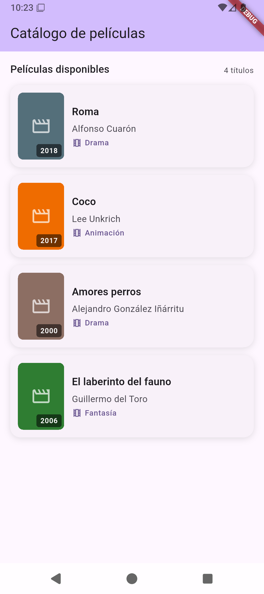

# Catálogo de películas: utilización de widgets

Hiram Agustín Acevedo López · Licenciatura en Desarrollo de Sistemas Web

Proyecto de la actividad 3.4 de Diseño de aplicaciones móviles. Es el catálogo de películas que vengo desarrollando en la unidad 3: aquí construyo su pantalla de catálogo con los cinco widgets básicos de Flutter (Text, Row, Column, Stack y Container). Parte del Hello World de la actividad 3.3 (https://github.com/hiramAcevedo/ih732_hello_world) y sigue el wireframe de la actividad 3.2.

## Dónde está cada widget

Todo en `lib/main.dart`. La pantalla es una lista de tarjetas, una por película, y cada tarjeta repite la misma composición.

| Widget | Dónde | Qué configuré |
|---|---|---|
| `Column` | el cuerpo de la pantalla (encabezado y tarjetas) y los datos de cada tarjeta | `crossAxisAlignment`, `mainAxisSize`, `spacing` |
| `Row` | cada tarjeta (póster a la izquierda, datos a la derecha), el encabezado y la línea del género | `mainAxisAlignment`, `crossAxisAlignment`, `textBaseline`, `spacing`, un hijo `Expanded` |
| `Stack` | el póster: el bloque de color debajo y, encima, el año en la esquina inferior derecha | `alignment`, `clipBehavior`, un hijo `Positioned` |
| `Container` | la tarjeta, el póster y la etiqueta del año | `margin`, `padding`, `width`, `height`, `alignment`, `decoration` (color, `borderRadius`, `boxShadow`) |
| `Text` | el nombre de la app, el encabezado, el título, el director, el género y el año | `style` del tema, `maxLines`, `overflow` |

Las películas están en `lib/pelicula.dart`. Son contenido de ejemplo mientras el catálogo no se conecta a un servicio.

## Abrir el proyecto

1. Clona el repositorio.
2. Con Flutter 3.47.5 instalado, entra a la carpeta y corre `flutter pub get`.
3. Enciende un emulador de Android (o conecta un teléfono) y corre `flutter run`. También corre en el navegador con `flutter run -d chrome`.

## Pruebas

`flutter test` corre seis pruebas de widget: una comprueba la barra y las cuatro películas; las otras cinco, una por widget, comprueban que cada uno está donde debe y con la configuración que le di (por ejemplo, que el año queda dentro del `Stack` a 4 px de la esquina del póster, o que la tarjeta tiene margen, relleno, esquinas redondeadas y sombra).

Hecho con Flutter 3.47.5 (Dart 3.13.4). Probado en el emulador Pixel 9 con Android 16 y en Chrome.
