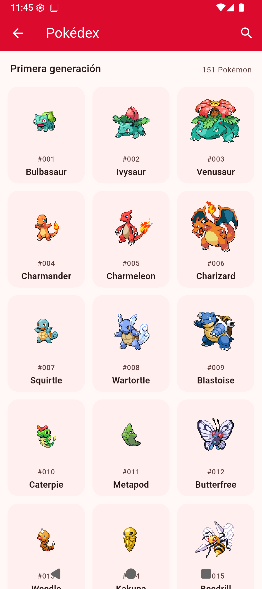
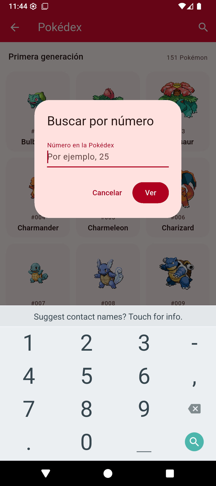
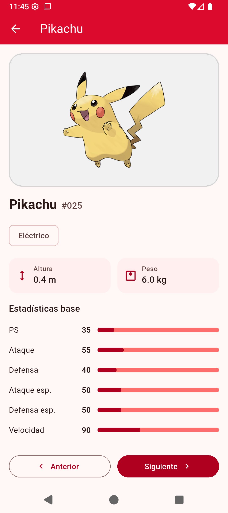

# Pokédex

Hiram Agustín Acevedo López · Licenciatura en Desarrollo de Sistemas Web

Aplicación en Flutter de la unidad 3 de Diseño de aplicaciones móviles. En la actividad 3.6 es una Pokédex: los 151 Pokémon de la primera generación, con los datos y las imágenes que pide a PokéAPI por HTTP. Cada actividad queda fija en una etiqueta del repositorio:

| Etiqueta | Actividad | Qué hay |
|---|---|---|
| `act-3.4` | 3.4. Utilización de widgets | la pantalla del catálogo de películas, con Text, Row, Column, Stack y Container |
| `act-3.5` | 3.5. Home screen | la pantalla de inicio del catálogo, con la imagen de fondo, el icono y el mensaje Hello World |
| `act-3.6` | 3.6. Peticiones HTTP | la Pokédex: el inicio, la lista y el detalle, con los datos de PokéAPI |

## Peticiones HTTP (actividad 3.6)

La app arranca en el inicio de la Pokédex. El botón Ver la Pokédex abre la lista de los 151 y, al tocar uno, su detalle. Los datos llegan de PokéAPI (https://pokeapi.co) con el paquete `http` y los pasos de la receta Fetch data from the internet (docs.flutter.dev/cookbook/networking/fetch-data).

| Pantalla | Petición | Qué muestra |
|---|---|---|
| `InicioPage` | ninguna | el nombre de la app, un texto corto y el botón Ver la Pokédex |
| `PokedexPage` | `GET https://pokeapi.co/api/v2/pokemon?limit=151` | el número, el nombre y la imagen de cada Pokémon, en una cuadrícula, y la lupa del buscador por número en la barra |
| `PokemonPage` | `GET https://pokeapi.co/api/v2/pokemon/{id}` | la imagen oficial, los tipos, la altura, el peso y las seis estadísticas base, con los botones Anterior y Siguiente |

El código está en `lib/pokeapi.dart` (las peticiones y los modelos), `lib/pokedex.dart` (la lista y el detalle) y `lib/inicio.dart` (el inicio):

1. `http` 1.6.0 está en `pubspec.yaml` y el permiso `INTERNET`, en el manifiesto de Android.
2. Cada petición usa `get` del paquete y sólo acepta el código 200; con cualquier otro lanza `PokeApiException`.
3. El cuerpo se convierte con `jsonDecode` y los constructores `PokemonResumen.fromJson` y `Pokemon.fromJson`.
4. La petición se lanza en `initState` y la pantalla la muestra con un `FutureBuilder`: un indicador mientras carga, los datos cuando llegan y, si falla, un mensaje con el botón Reintentar.
5. En el detalle, Anterior y Siguiente cambian de Pokémon y lanzan su petición, sin volver a la lista. Anterior está deshabilitado en el #001 y Siguiente en el #151.
6. La lupa de la barra de la lista abre el buscador: pide el número con el teclado numérico y abre directo el detalle de ese Pokémon, donde siguen Anterior y Siguiente. Si el número no está entre 1 y 151, avisa "Escribe un número del 1 al 151".

Usé PokéAPI porque, de las cuatro APIs que proponía la actividad, es la única que hoy responde sin llave ni registro. Lo comprobé el 7 de noviembre de 2026: la de Marvel devuelve error 500 y su portal de desarrolladores ya no existe, OpenWeatherMap pide una llave para cada petición y COVID Tracking dejó de actualizarse el 7 de marzo de 2021.

En esta versión la app es sólo la Pokédex; el catálogo de películas de las actividades 3.4 y 3.5 sigue en sus etiquetas.

## Abrir el proyecto

1. Clona el repositorio.
2. Con Flutter 3.47.5 instalado, entra a la carpeta y corre `flutter pub get`.
3. Enciende un emulador de Android (o conecta un teléfono) y corre `flutter run`. También corre en el navegador con `flutter run -d chrome`.

La Pokédex necesita conexión a internet; sin ella muestra el mensaje con el botón Reintentar.

## Pruebas

`flutter test` corre nueve pruebas. Todas usan el cliente simulado del paquete `http` (`MockClient`), así que no salen a internet:

- `test/pokeapi_test.dart`, tres: la dirección que se pide y la conversión del JSON en la lista y en el detalle, y que una respuesta distinta de 200 lanza `PokeApiException`.
- `test/pokedex_test.dart`, cuatro: sin conexión, la lista muestra el mensaje y Reintentar la trae; Anterior y Siguiente piden el Pokémon de al lado; Anterior está deshabilitado en el #001 y Siguiente en el #151; el buscador usa el teclado numérico, avisa con 0 y con 152 y, con el 25, abre su detalle, donde Siguiente lleva al 26.
- `test/inicio_test.dart`, dos: la app arranca en el inicio y Ver la Pokédex abre la lista.

Hecho con Flutter 3.47.5 (Dart 3.13.4). Probado en el emulador Pixel 9 con Android 16.
